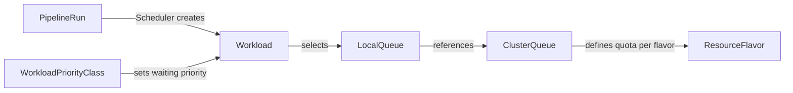

# Core Concepts

Scheduler connects a PipelineRun to a Kueue quota through a namespace-local queue. Administrators create the queues and resource flavors; Scheduler creates a Workload for each managed run.

## Resource relationships \{#resource_relationships}

The following diagram shows how a PipelineRun selects a quota pool. Multiple LocalQueues can share one ClusterQueue.



| Resource | Scope | Managed by | Purpose |
| --- | --- | --- | --- |
| TektonConfig | Cluster | Cluster administrator | Enables Scheduler and supplies its configuration. |
| TektonScheduler | Cluster | Tekton Operator | Installs and reports the status of the Scheduler component. |
| ResourceFlavor | Cluster | Cluster administrator | Identifies a flavor for resources offered by a ClusterQueue. |
| ClusterQueue | Cluster | Cluster administrator | Defines quota, eligible namespaces, and queueing policy. |
| LocalQueue | Namespace | Namespace or cluster administrator | Connects runs in one namespace to a ClusterQueue. |
| WorkloadPriorityClass | Cluster | Cluster administrator | Defines the priority value used to order waiting Workloads. |
| PipelineRun | Namespace | Pipeline author | Describes the pipeline to execute after admission. |
| Workload | Namespace | Scheduler and Kueue | Tracks a run's quota request and admission state. |

Use [Scheduler Configuration](../configure/scheduler_configuration.mdx) to enable the component through TektonConfig. The following examples explain the resources used after enablement. They share the names from the [Quick Start](../quick_start.mdx).

## Resource flavors \{#resource_flavors}

A ResourceFlavor names a resource flavor that a ClusterQueue can offer. For a concurrency-only quota, an empty flavor is sufficient:

```yaml
apiVersion: kueue.x-k8s.io/v1beta2
kind: ResourceFlavor
metadata:
  name: scheduler-demo
spec: {}
```

The ClusterQueue references this object by name. A flavor does not allocate infrastructure by itself. Scheduler's PipelineRun integration uses it for quota admission; do not assume that flavor node labels will be copied into the execution Pods of a PipelineRun. Configure execution placement through Tekton's Pod configuration.

See the [ResourceFlavor API](../../apis/kubernetes_apis/scheduler/resourceflavors.mdx) for field definitions.

## Cluster queues \{#cluster_queues}

A ClusterQueue defines the quota available for admission. This example allows only the `scheduler-demo` namespace to use a single PipelineRun slot:

```yaml
apiVersion: kueue.x-k8s.io/v1beta2
kind: ClusterQueue
metadata:
  name: scheduler-demo
spec:
  namespaceSelector:
    matchLabels:
      kubernetes.io/metadata.name: scheduler-demo
  resourceGroups:
    - coveredResources: [tekton.dev/pipelineruns]
      flavors:
        - name: scheduler-demo
          resources:
            - name: tekton.dev/pipelineruns
              nominalQuota: 1
```

| Field | Meaning in this example |
| --- | --- |
| `namespaceSelector` | Allows Workloads only from the named namespace. An empty selector `{}` allows all namespaces; an omitted selector allows none. |
| `resourceGroups[].coveredResources` | Lists the quota resources managed by this group. |
| `resourceGroups[].flavors[].name` | References the ResourceFlavor that must already exist. |
| `resources[].nominalQuota` | Supplies one concurrency slot for `tekton.dev/pipelineruns`. |

Quota belongs to the ClusterQueue. All LocalQueues that reference it share that quota. For a strict isolated limit, use a dedicated ClusterQueue without a cohort or borrowing configuration.

See the [ClusterQueue API](../../apis/kubernetes_apis/scheduler/clusterqueues.mdx) for queueing strategy, quota fields, and status conditions.

## Local queues \{#local_queues}

A LocalQueue selects a ClusterQueue for runs in its own namespace:

```yaml
apiVersion: kueue.x-k8s.io/v1beta2
kind: LocalQueue
metadata:
  name: pipelines-queue
  namespace: scheduler-demo
spec:
  clusterQueue: scheduler-demo
```

The namespace must exist before this object is created. A PipelineRun in another namespace cannot select this LocalQueue. To share the same ClusterQueue with another namespace, create a LocalQueue there as well.

`spec.clusterQueue` is immutable. Create a new LocalQueue and update future submissions when changing the ClusterQueue binding.

See the [LocalQueue API](../../apis/kubernetes_apis/scheduler/localqueues.mdx).

## Namespace enrollment \{#namespace_enrollment}

The namespace label `tekton.dev/scheduler-enabled: "true"` enables the Scheduler admission webhook for newly created PipelineRuns. Prepare the queues before adding the label:

```bash
kubectl get localqueue pipelines-queue -n scheduler-demo
kubectl label namespace scheduler-demo tekton.dev/scheduler-enabled=true
```

A PipelineRun can select a LocalQueue with the `kueue.x-k8s.io/queue-name` label. If the label is absent, Scheduler assigns the queue name configured in TektonConfig. This example selects the queue explicitly and references an existing `build` Pipeline:

```yaml
apiVersion: tekton.dev/v1
kind: PipelineRun
metadata:
  name: queued-build
  namespace: scheduler-demo
  labels:
    kueue.x-k8s.io/queue-name: pipelines-queue
spec:
  pipelineRef:
    name: build
```

See the [PipelineRun API](../../apis/kubernetes_apis/pipelines/tekton.dev_pipelineruns.mdx) for submission fields, including `pipelineRef` and the inline `pipelineSpec` used by the Quick Start.

Removing the enrollment label affects new submissions. It does not release existing queued runs. Queue labels select configuration; namespace permissions and the ClusterQueue namespace selector control access.

## Quota accounting \{#kueue_resource_model}

Each managed PipelineRun requests one unit of `tekton.dev/pipelineruns`. A ClusterQueue with `nominalQuota: 1` admits one run at a time. Excess runs wait with `spec.status: PipelineRunPending`.

CPU, memory, storage, ephemeral storage, and custom capacity requests are supplied through `kueue.konflux-ci.dev/requests-*` annotations. Kueue admits a Workload only when every requested resource fits the selected ClusterQueue. For example, a queue with four slots and eight CPUs can admit at most four runs and at most eight requested CPUs simultaneously.

Kueue accounts for declared requests, not measured use. Pod resource requests and limits do not automatically become PipelineRun quota requests. A single admitted PipelineRun can execute several Tasks concurrently. See [Resource Quotas](../guides/resource_quotas.mdx) for complete examples.

### Concurrency quota \{#concurrency_quota}

The `tekton.dev/pipelineruns` resource counts admitted PipelineRuns, regardless of their Task or Pod count. Sharing a ClusterQueue shares this count across its LocalQueues. Use a dedicated quota-one ClusterQueue to serialize known workloads; use independent queues for work that can run in parallel.

## Workload priorities \{#workload_priorities}

A WorkloadPriorityClass defines a numeric priority. Higher values take precedence among waiting Workloads in the same ClusterQueue:

```yaml
apiVersion: kueue.x-k8s.io/v1beta2
kind: WorkloadPriorityClass
metadata:
  name: pipelines-high
value: 100
description: Prioritize release pipelines waiting for quota.
```

Select this class using the PipelineRun label `kueue.x-k8s.io/priority-class: pipelines-high`, or assign it through the CEL `priority()` function. The class must exist before submitting the run. Priority does not supply extra quota or guarantee interruption of an already admitted run.

See [Priorities and Serial Execution](../guides/priorities_and_serial_execution.mdx) for an admission-order example and the [WorkloadPriorityClass API](../../apis/kubernetes_apis/scheduler/workloadpriorityclasses.mdx) for field definitions.

## Admission lifecycle \{#admission_lifecycle}

1. The webhook assigns a queue to a new PipelineRun in an enrolled namespace and sets `spec.status: PipelineRunPending`.
2. Scheduler creates a Workload in the same namespace, owned by the PipelineRun.
3. Kueue reserves quota and admits the Workload when the request fits.
4. Scheduler clears the pending status. Tekton then creates TaskRuns and execution Pods.
5. On completion, the Workload finishes and releases its quota for waiting runs.

The following is an illustrative excerpt from an admitted Workload, not a manifest to apply. Scheduler supplies the remaining fields, including the quota request under `spec.podSets`:

```yaml
apiVersion: kueue.x-k8s.io/v1beta2
kind: Workload
metadata:
  name: pipelinerun-queued-build-example
  namespace: scheduler-demo
spec:
  queueName: pipelines-queue
status:
  conditions:
    - type: QuotaReserved
      status: "True"
    - type: Admitted
      status: "True"
```

| State | PipelineRun | Workload |
| --- | --- | --- |
| Waiting for quota | `spec.status: PipelineRunPending`; no TaskRun or execution Pod. | Quota is not reserved; inspect condition reasons and messages. |
| Admitted | Pending status is cleared; execution can begin. | `QuotaReserved=True` and `Admitted=True`. |
| Completed | `Succeeded` condition reports the execution result. | `Finished=True`; quota is released. |

Read the [Workload API](../../apis/kubernetes_apis/scheduler/workloads.mdx) for the full schema. Use [Troubleshoot Scheduler](../trouble_shooting/scheduler_not_ready.mdx) when admission stalls.

Disabling Scheduler does not drain or resume queued work. Follow [Disable Scheduler](../guides/manage_scheduler.mdx#disable_scheduler) while the component is still running.
